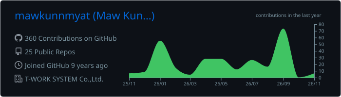
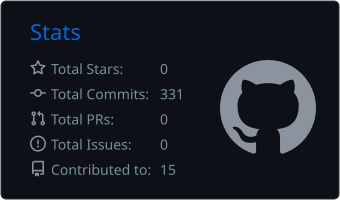
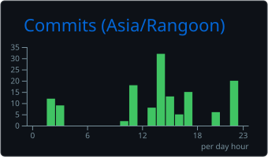
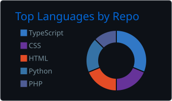
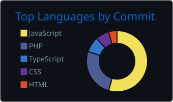

<!-- Header -->
<p align="center">
  
</p>

<p align="center">
  <a href="https://www.linkedin.com/in/mapoeeiphyu/"></a>
  <a href="https://www.chuelay.com"></a>
  <a href="https://github.com/mawkunnmyat?tab=repositories"></a>
</p>

<p align="center">
  
  
  
</p>

---

## 👋 About me

I'm a **Software Engineer at [T-WORK SYSTEM Co., Ltd.](https://www.chuelay.com)** in Myanmar 🇲🇲.
I build **cross-platform mobile apps**, **WordPress / WooCommerce backends** and the **tooling around them** — from the Flutter client to the REST API, load tests and automation scripts.

```yaml
role:        Software Engineer
company:     T-WORK SYSTEM Co., Ltd.
location:    Myanmar
focus:       [Flutter apps, WordPress REST APIs, WooCommerce, AI-assisted tools]
languages:   [Dart, TypeScript, JavaScript, PHP, Python]
on_github:   since 2017
```

## 🎯 What I'm working on

- 📱 **Flutter commerce & rewards apps** backed by custom **WordPress REST APIs**
- 🛍️ **WooCommerce themes** and storefronts with a modern UI
- 🤖 **LLM-powered tools (Gemini)** for real workflows — like automated exam marking
- ⚡ **Performance testing with k6** before every release
- 🧰 **Python automation** for everyday PDF and image work

## 🛠️ Tech stack

<p align="center">
  
  <br />
  
</p>

| Area | Tools |
|---|---|
| 📱 **Mobile** | Flutter · Dart · Ionic |
| 🌐 **Frontend** | TypeScript · React · Next.js · JavaScript · HTML · CSS / SCSS · GSAP |
| 🗄️ **Backend** | PHP · WordPress · WooCommerce · Laravel · REST APIs |
| 🤖 **AI** | Google Gemini API |
| 🧪 **Testing & Perf** | k6 load testing · Flutter analyze / test |
| ⚙️ **DevOps & Tools** | Git · GitHub Actions · Python scripting |

## 🚀 Featured projects

| | Project | What it does | Stack |
|:-:|---|---|---|
| 🎓 | [**Chan Auto Mark**](https://github.com/mawkunnmyat/autograding) | AI marking pipeline: question paper + marking scheme PDFs + student DOCX → task-level scores, bilingual (EN / Myanmar) feedback and Excel export. Chunked uploads and staged jobs keep it within serverless limits. | Next.js · TypeScript · Gemini |
| 🛍️ | [**srtheme**](https://github.com/mawkunnmyat/srtheme) | Modern WooCommerce WordPress theme with a custom storefront and product grid. | PHP · WordPress · WooCommerce |
| ⚡ | [**speed_test**](https://github.com/mawkunnmyat/speed_test) | k6 load-testing suite that simulates real mobile-app sessions against a WordPress REST API, with SLA thresholds. | k6 · JavaScript |
| 📄 | [**PDF-Compressor**](https://github.com/mawkunnmyat/PDF-Compressor) | CLI that flattens and compresses PDFs while keeping the layout readable. CI-tested. | Python |
| ✂️ | [**PDF-Customizer**](https://github.com/mawkunnmyat/PDF-Customizer) | Splits a master PDF into personalised reports automatically. | Python · pypdf |
| 🖼️ | [**Image-Compressor**](https://github.com/mawkunnmyat/Image-Compressor) | Shrinks PNG / JPEG / WebP files without changing resolution. | Python · Pillow |
| ✨ | [**gsap-animation**](https://github.com/mawkunnmyat/gsap-animation) | Scroll-driven landing page built with GSAP, ScrollTrigger and Lenis. | HTML · CSS · JavaScript |

## 📊 GitHub stats

<p align="center">
  
</p>

<p align="center">
  
  
</p>

<p align="center">
  
  
</p>

<p align="center">
  
</p>

## 💡 How I work

- ✅ **Ship small, test early** — analyze, unit tests and load tests before release
- 🔐 **Security by default** — validated input, escaped output, no secrets in code
- 📚 **Document everything** — every repo gets a clear README
- 🤝 **Clean handoffs** — conventional commits and readable PRs

## 🤝 Let's connect

I'm open to collaborating on **Flutter**, **WordPress / WooCommerce** and **automation** projects.

<p>
  <a href="https://www.linkedin.com/in/mapoeeiphyu/"></a>
  <a href="https://www.chuelay.com"></a>
</p>

<!-- Footer -->
<p align="center">
  
</p>
